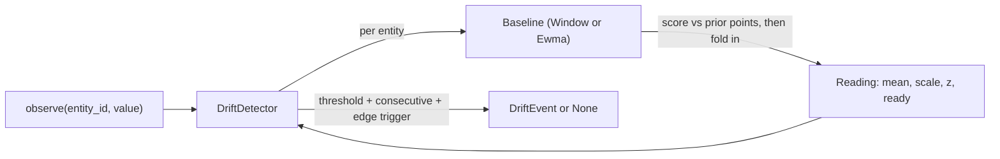

# driftline: review guide

Orientation for a working Python or ML engineer. Read this first, then `RUNBOOK.md`
to run anything. The `README.md` is the user-facing introduction and quickstart; this
document is for someone reviewing the code.

## 1. What this is

driftline is a small, self-contained library for online per-entity anomaly detection.
It monitors many streams at once (sensors in a fleet, servers in a cluster, accounts on
a platform) and flags when a stream departs from its own recent normal, rather than from
a single threshold learned across the whole population. A value that is routine for one
entity and alarming for another is read correctly in both.

It is pure Python standard library: no numpy, no pandas, no config file, no network
surface. Python 3.10 or later. The public API is three estimators and one detector. It is
a demonstration library, released MIT under `LICENSE`, versioned 0.1.0. Maturity stated
honestly: the code is complete, typed, tested, and CI-linted, and the central claim is
backed by a reproducible synthetic benchmark. It has not been run against a published
real-world dataset in this repository, and the benchmark is synthetic by construction
(see the honesty notes in section 4).

This repository is public and stands alone. It has no dependency on, and makes no
reference to, any other system. There is nothing regulated, export-controlled, or
otherwise sensitive in it. Reviews and edits should keep it that way: it is an
anomaly-detection demo and nothing else.

## 2. Code map (where the load-bearing logic lives)

The whole package is four files under `driftline/`, plus a benchmark and tests. Ordered
by importance to a reviewer:

- `driftline/baseline.py`: the scoring core. This is where the real logic lives. Defines
  `Reading` (the frozen result of scoring one value), the `Baseline` protocol, and the two
  estimators: `WindowBaseline` (exact over a sliding window, optional robust median/MAD
  path, warmup, and a floor on scale) and `EwmaBaseline` (constant-memory exponentially
  weighted mean and variance, incremental West 1979 update). The causal-scoring rule
  (score against prior points, then fold the value in) is implemented in
  `WindowBaseline.observe` and `EwmaBaseline.observe`. Review this file first and most
  carefully.
- `driftline/detector.py`: `DriftDetector`, the multi-entity layer over the baselines. Holds
  one baseline per entity, applies consecutive-sample confirmation (`consecutive=N`) and
  edge triggering (one `DriftEvent` per sustained episode, not one per breaching sample),
  and exposes `forget`/`reset`/`n_entities` for state release. The event-emission state
  machine is in `observe`.
- `driftline/robust.py`: `mad` (median absolute deviation) and `robust_scale`
  (`1.4826 * MAD`, a standard-deviation-comparable scale that ignores outliers). Small and
  pure; the constant is standard, not tuned.
- `driftline/__init__.py`: the public surface. Re-exports `Baseline`, `Reading`,
  `WindowBaseline`, `EwmaBaseline`, `DriftDetector`, `DriftEvent`, `mad`, `robust_scale`,
  and `__version__`. `py.typed` ships the type markers.
- `benchmarks/per_entity_vs_global.py`: the reproducible evidence for the per-entity claim.
  Builds a synthetic population, injects sustained shifts into some streams, and scores
  per-entity detection against a single global band at the episode level. Deterministic
  given the seed.
- `tests/`: `test_baseline.py` (causal scoring, hand-checked z arithmetic, robust
  contamination, warmup, the divide-by-zero floor, EWMA), `test_detector.py` (per-entity
  independence, consecutive confirmation, edge triggering, state release), `test_robust.py`
  (MAD arithmetic and outlier resistance).
- `docs/adr/0001-per-entity-baselines.md`: the decision record for scoring per entity
  rather than globally, including the alternatives considered and the homogeneous-stream
  caveat.

## 3. Architecture in brief

The layering is clean. `Baseline` is a `Protocol` (structural typing), so `WindowBaseline`
and `EwmaBaseline` are interchangeable and a new estimator is a drop-in that implements
`observe` and `ready`. The `DriftDetector` owns none of the statistics; it dispatches to a
per-entity baseline and adds only the multi-stream discipline (confirmation, debounce,
state release). Scoring is causal at the baseline layer: `observe` computes the `Reading`
against the points already seen, then appends the new value, so an anomaly cannot inflate
its own baseline and shrink its own score. There is no I/O, no global state, and no
framework in the path.

## 4. What to review, and how it is verified

Suggested order:
1. `driftline/robust.py`: smallest surface, pure functions. Confirm `mad` and the
   `1.4826` scale factor.
2. `driftline/baseline.py`: the core. Confirm the causal rule (the value is scored before
   `self._buf.append(value)` / before the EWMA update), the robust path switching both the
   center (median) and the scale (MAD) together, the warmup gate returning `ready=False`
   with `z=0.0`, and `min_scale` flooring the divisor.
3. `driftline/detector.py`: confirm the streak/firing state machine: below threshold or
   warming up resets the episode; at or above threshold it counts breaches, emits one event
   when the streak reaches `consecutive`, and suppresses repeats until the stream clears.
4. `benchmarks/per_entity_vs_global.py`: confirm the episode-level scoring and that the
   comparison is fair (the global band is calibrated on a warmup slice of every stream,
   the same way a real global monitor would be).
5. `tests/`: the tests are the specification. Each one names the property it protects.

How it is verified in this repository:
- 26 tests, run with `pytest -q`, pass in well under a second with no external
  dependencies. `RUNBOOK.md` section 4 has the exact command and the observed count.
- `ruff check .` is clean (rule sets E, F, I, UP, B).
- CI (`.github/workflows/ci.yml`) runs lint, tests, and a benchmark smoke run on Python
  3.10, 3.11, and 3.12.
- The benchmark is reproducible: it prints the same numbers every run for a fixed seed,
  and those numbers match the `README.md` table.

Honesty notes a reviewer needs:
- The benchmark is synthetic. It builds Gaussian streams and injects known shifts; it is
  evidence that per-entity scoring behaves as claimed on data with that structure, not a
  measurement on a real dataset.
- The benchmark's per-entity precision is modest (roughly 0.28 to 0.32 in the printed
  runs) because the detector raises a fair number of false-alarm runs. The claim the
  benchmark supports is the recall and the heterogeneous contrast, where the global band
  catches zero episodes and per-entity catches almost all of them. The README states this
  and the homogeneous case, where a pooled global estimate is a little better, without
  hiding either. Do not read the benchmark as a precision claim.
- The benchmark exercises `WindowBaseline` scoring directly (raw threshold flags), not the
  full `DriftDetector` debounce and edge-trigger layer. It measures the baseline claim,
  not the detector's event de-duplication. Both are covered by tests, but they are covered
  separately.

## 5. Known gaps and open items (named, not hidden)

- No real-dataset evaluation is included. The only quantitative evidence is the synthetic
  benchmark. Adding a run against a public labeled stream would strengthen the claim; it is
  not present.
- No command-line interface. `python -m driftline` does not run (there is no
  `__main__.py`); the package is used as a library or through the benchmark script. This is
  by design for a library, noted here so no one goes looking for a CLI.
- Univariate only. One number per entity per step. Not a forecaster, not a classifier, not
  multivariate. The `README.md` scope section states this.
- The window baseline recomputes mean and scale over the window on every scored sample
  (`fmean`/`pstdev`, or `median`/`robust_scale`), which is O(window) per observation and
  O(window log window) on the robust path. Fine for the intended scale; not optimized for
  very large windows or very high throughput.
- Per-entity memory grows with the number of live entities. `forget` and `reset` exist to
  bound it, but the caller must call them; there is no automatic eviction of stale entities.
- The clustering middle-ground (one baseline per cluster of entities) is discussed in ADR
  0001 as a deliberate deferral, not implemented.
